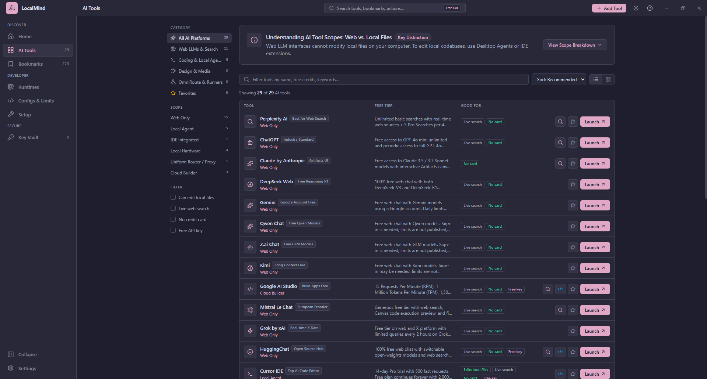

# LocalMind

> **Your private AI hub, always nearby.**

LocalMind (`/LOH-kul-MYND/`) is a free, open-source desktop app that catalogs free-tier AI tools, finds the AI servers running on your machine, and keeps your API keys in an encrypted local vault. There is no account and no telemetry: your data stays on your computer.

[**Documentation**](https://zelucode.github.io/localmind/) · [**Download**](https://github.com/zelucode/localmind/releases) · [Changelog](CHANGELOG.md) · [Contributing](CONTRIBUTING.md)



| | |
|---|---|
| **Version** | 1.0.0-beta.1 |
| **Platforms** | Windows, macOS, Linux (tested on Windows; see [status](#status)) |
| **Built with** | Tauri 2 (Rust) · React 19 · TypeScript · Vite · Tailwind CSS 4 |
| **License** | [Apache 2.0](LICENSE) |

## Why LocalMind

The AI tooling landscape moves quickly, and the same problems keep coming up:

1. **Fragmentation.** Hundreds of models, web UIs, agents and APIs exist. Finding ones with a useful, renewing free tier that does not demand a credit card is slow.
2. **Web versus local confusion.** Browser chatbots cannot touch your repository. Local agents (Aider, Cline, Cursor and others) can edit files and run commands. The difference matters and is rarely labeled.
3. **Key and rate-limit fatigue.** Free keys from Gemini, Groq, Mistral and OpenRouter each have different limits, base URLs and model IDs. Juggling them breaks your flow.

LocalMind puts the catalog, the local runtimes and the keys in one desktop window.

## Features

- **AI Tools:** 29 free-tier tools, each badged with what it can really do (`web-only`, `local-agent`, `ide-plugin`, `local-runner`, `uniform-proxy`, `cloud-builder`). Filter, search, sort, favorite, add your own, and send a prompt to a tool with Quick Query.
- **Ask box:** type a prompt once and open it in the AI you choose, or in up to five at once.
- **Bookmarks:** 270 curated free web tools, with import and export as JSON, browser HTML, CSV and Markdown.
- **Runtimes:** detects Ollama, LM Studio, Jan and OmniRoute on your machine.
- **Setup:** one-click install and detection of Ollama, LM Studio, Gemini CLI and Qwen Code. You confirm the exact command first.
- **Key Vault:** API keys encrypted with AES-256-GCM, with the master key in your operating system's credential store. Test a key against Gemini, OpenRouter, Groq, OpenAI, DeepSeek, Mistral or Anthropic.
- **Config Exporter:** copy-ready setups for Continue, Cline, Cursor, Aider, Windsurf, the Python and TypeScript SDKs, and cURL.
- **Rate-Limit Matrix:** side-by-side free-tier quotas, with the date each was last reviewed and an optional live data feed.
- **Backups:** back up and restore your workspace. Backups that include keys can be protected with a passphrase (Argon2id and AES-256-GCM).
- **Themes:** 10 built-in themes, an accent color, and editable theme JSON.

## Install

Download the installer for your system from the [Releases page](https://github.com/zelucode/localmind/releases). The installers are not code-signed yet, so Windows SmartScreen and macOS Gatekeeper will warn on first launch. The [install guide](https://zelucode.github.io/localmind/guide/install) explains what to do.

## Build from source

You need [Node.js](https://nodejs.org/) 20 or newer, [pnpm](https://pnpm.io/) 12, [Rust](https://www.rust-lang.org/tools/install) (stable) and the [Tauri 2 prerequisites](https://tauri.app/start/prerequisites/) for your system.

```sh
git clone https://github.com/zelucode/localmind.git
cd localmind
pnpm install
pnpm tauri dev      # run the desktop app (the first Rust build takes several minutes)
pnpm tauri build    # produce an installer for your system
```

Run `pnpm test:all` (type check, frontend tests and Rust tests) before opening a pull request. See [Contributing and development](https://zelucode.github.io/localmind/development/) for the full command list, the project layout and the architecture.

## Status

LocalMind is in beta.

- **Platforms:** tested on Windows. macOS and Linux installers are built by the release workflow but have not been run on real machines.
- **Signing:** installers are not code-signed.
- **Updates:** there is no automatic update check. Install new versions by hand.
- **Advisor:** a free-tier advisor is built and tested, but hidden until its provider choice is settled.

## Privacy

Your tools, bookmarks, settings and keys are stored on your computer only. LocalMind contacts a provider only when you press **Test** on a key, and it downloads provider data only if you set a feed address. See [Privacy and security](https://zelucode.github.io/localmind/guide/privacy-and-security) for exactly what is stored and sent.

## Contributing

Contributions are welcome. See [CONTRIBUTING.md](CONTRIBUTING.md); commits need a DCO sign-off (`git commit -s`). Report security problems privately as described in [SECURITY.md](SECURITY.md).

## License

LocalMind is open source under the [Apache License 2.0](LICENSE). Copyright 2026 Haroon Abbasi; see [NOTICE](NOTICE).

The LocalMind name and logo are not covered by the code license. See [TRADEMARKS.md](TRADEMARKS.md) before shipping a fork.
