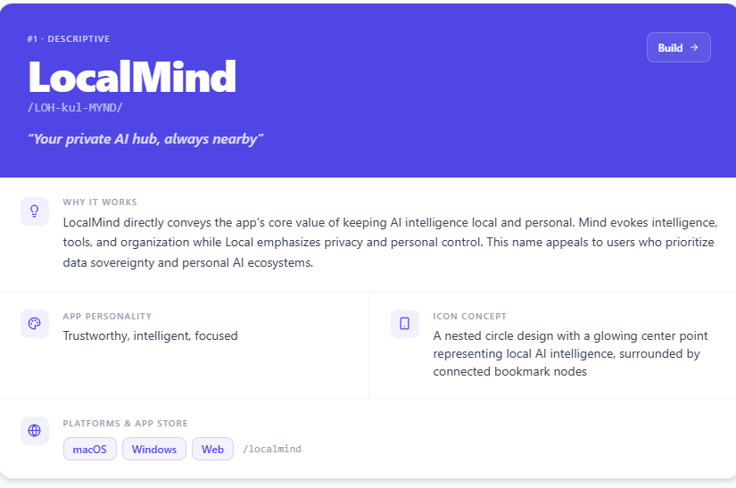

# LocalMind

> **Your private AI hub, always nearby.**

LocalMind (`/LOH-kul-MYND/`) is a cross-platform desktop app that catalogs free-tier AI tools, monitors the AI daemons running on your machine, and keeps your API keys in a local vault. It is built with Tauri 2 (Rust shell) and a React 19 frontend.

| | |
|---|---|
| **Version** | 0.1.0 (early development) |
| **Platforms** | Windows, macOS (Tauri bundles for Linux as well) |
| **App identifier** | `com.localmind.app` |
| **Stack** | Tauri 2 · React 19 · TypeScript · Vite 6 · Tailwind CSS 4 |
| **Data** | Local only — everything is stored on-device; no account, no telemetry |



---

## Table of contents

1. [Why LocalMind](#why-localmind)
2. [Features](#features)
3. [Branding & identity](#branding--identity)
4. [Getting started](#getting-started)
5. [Project structure](#project-structure)
6. [Tech stack](#tech-stack)
7. [Current status & known limitations](#current-status--known-limitations)
8. [Documentation](#documentation)

---

## Why LocalMind

The AI tooling landscape moves quickly, and developers keep running into the same problems:

1. **Fragmentation.** Hundreds of models, web UIs, agents and APIs exist. Finding ones with a useful, renewing free tier that doesn't demand a credit card is slow.
2. **Web vs. local confusion.** Browser chatbots can't touch your repo. Local agents (Aider, Cline, Cursor, ...) can edit files and run commands. The difference matters and is rarely labeled.
3. **Key and rate-limit fatigue.** Free keys from Gemini, Groq, Mistral, OpenRouter and GitHub Models each have different limits, base URLs and model IDs. Juggling them breaks flow.

LocalMind puts the catalog, the local runtimes and the keys in one desktop window.

### Design principles

- **Privacy first.** API keys and all user data live in the webview's `localStorage` on your machine. Nothing is sent anywhere unless you explicitly test a key or call a provider.
- **Scope clarity.** Every tool is badged with what it can really do: `web-only`, `local-agent`, `ide-plugin`, `local-runner`, `uniform-proxy`, `cloud-builder`.
- **No "AI slop" aesthetics.** No neon glows, purple gradients or marketing copy. The look is drafting-table and stationery inspired: calm, tactile, ergonomic.
- **Fully themeable.** The UI is styled through CSS variables (`--theme-*`), so palettes can be swapped or edited live.

---

## Features

### Free-tier tool catalog (Dashboard)
- 25+ curated tools across web LLMs, coding agents, design/media, local runners and routers (e.g. Perplexity, DeepSeek, Google AI Studio, Mistral Le Chat, Cursor, Aider, Windsurf, v0, Bolt.new, OmniRoute, Ollama, OpenRouter, LM Studio, Jan).
- Each card shows the free-tier summary, limits, reset cycle, whether web search is included, whether a credit card is required, and whether a custom API key is allowed.
- Filter by category (web LLM, coding agent, design/media, uniform proxy, custom) and by capability scope.
- Favorites, add-your-own tools, and an in-app explainer for the scope badges.
- Quick-launch: type a prompt once and open it in the chosen platform.

### Local daemon monitor
- Probes localhost for AI runtimes: **OmniRoute** (`8000`), **Ollama** (`11434`), **LM Studio** (`1234`), **Jan.ai Cortex** (`1337`), plus a custom port probe.
- Copy-ready install/start commands per runtime.
- Guidance for fronting free Gemini, Groq and Mistral keys with OmniRoute's OpenAI-compatible endpoint (`http://localhost:8000/v1`).

### API key vault
- Store and label keys for Gemini, Groq, Mistral, Hugging Face, OpenRouter and GitHub Models.
- Mask/reveal, one-click copy, direct links to each provider's key console, live connection test.

### IDE & agent config exporter
- Pick a target (Cline, Continue.dev, Cursor, Aider, Windsurf, Python/TS SDK) and a provider, and get a copyable config snippet with the right base URL, env var names and model IDs.

### Rate-limit & rotation matrix
- Side-by-side RPM / TPM / daily-cap / context-window comparison for free tiers, plus a 4-tier rotation strategy for zero-cost daily coding.

### AI architecture advisor
- Describe a task and get a recommended free-tier stack, with rule-based fallback advice when no AI backend is available.

### Bookmarks library
- ~270 curated bookmarks in 9 categories (developer, design, productivity, utilities, converters, media, education, security, AI utilities), with search, favorites, click counts and custom entries.
- Export/import bookmarks and export the catalog as Markdown.

### Productivity
- Global search modal (`Omnibar` / quick search), keyboard-shortcut cheat sheet, startup welcome screen and optional loading screen.
- Full JSON backup/restore of tools, keys, favorites, bookmarks and theme settings; factory reset.

### Theming
- 13 built-in presets, including **Pastel Dusk** (default dark), **Blueprint** (technical navy on cool white) and **Soft Paper** (warm cream with vermillion), plus Cyberpunk Teal, Obsidian Emerald, Midnight Violet, Nordic Ice Blue, Solar Amber, Crimson Rose, Pitch Black OLED, Graphite, Concrete and Pastel Lavender Light.
- Custom accent color picker and an editable theme-JSON schema.

---

## Branding & identity

This section summarizes the brand identity and how the brand kit has been applied.

### Name
- **LocalMind**, pronounced `/LOH-kul-MYND/`. One word, camel-cased "L" and "M".
- *Local* signals privacy and personal control. *Mind* signals intelligence, tools and organization.
- Tagline: **"Your private AI hub, always nearby."**
- Suggested handle / slug: `/localmind`.

### Personality
Trustworthy, intelligent, focused. Calm and craftsmanlike rather than hype-driven. It should read as a dependable developer instrument, not a consumer AI toy.

### Icon concept
A **nested-circle design with a glowing center point**, representing local AI intelligence, surrounded by **connected bookmark nodes** (the catalog of tools orbiting the user's own machine).

Notes for the designer:
- It must hold up at 16 px (tray/taskbar) up to 1024 px (store art), in light and dark.
- The "glow" should be subtle (a soft center accent), consistent with the no-neon principle.
- Prefer flat, geometric shapes; avoid gradients-for-the-sake-of-gradients, robots, brains and sparkle clichés.

### Brand kit & current status
The finished brand kit (direction A, "Orbit") lives in [branding/localmind-brand-kit/](branding/localmind-brand-kit/). Open `brand-guide.html` there for the full guide. It contains the app icon (full, small and tiny size tiers), logos and wordmarks, favicons, tray icons, social assets, and design tokens.

Applied in the app:
- Tauri icons: [src-tauri/icons/](src-tauri/icons/) (from `tauri-icons/`)
- Favicon, touch icon and web manifest: [public/](public/), linked from [index.html](index.html)
- In-app mark: [BrandMark.tsx](src/components/BrandMark.tsx), used in the sidebar, header and loading screen
- Boot splash in `index.html`, recolored to the brand palette
- Cargo and `metadata.json` descriptions

Not yet applied: tray icons (`tray/`; the app has no tray yet) and the wordmark/stacked logos (no in-app spot uses them yet).

To refresh the icons after changing the master: `pnpm tauri icon branding/localmind-brand-kit/app-icon/icon-master-1024.png`. Note the kit's `.icns` uses the padded macOS variant, which the generator would not produce, so prefer copying `tauri-icons/` as-is.

### Color palette
The UI is token-driven, so brand colors should map onto the existing theme tokens. The three signature themes:

| Theme | Mode | Primary | Canvas | Card | Text |
|---|---|---|---|---|---|
| **Pastel Dusk** (default) | dark | `#e0a8c5` | `#1e1e2e` | `#282838` | `#d8dbe8` |
| **Blueprint** | light | `#1d4ed8` | `#eff6ff` | `#ffffff` | `#0f172a` |
| **Soft Paper** | light | `#f7591f` | `#f6f4ee` | `#ffffff` | `#1c1917` |

Brand tokens (from `branding/localmind-brand-kit/tokens/`): primary `#e0a8c5`, primary on light `#a8497f`, canvas `#1e1e2e`, card `#282838`, icon tile `#232336`, text `#d8dbe8`, muted `#8e92a8`, paper `#f6f4ee`. Full theme definitions live in [src/theme.ts](src/theme.ts).

### Typography
The wordmark is Inter Light ("Local") + Inter Bold ("Mind"), outlined in the SVGs. The UI uses the system/Tailwind default sans stack, with monospace for commands and ports.

### Where branding appears in the product
- Window title and product name: `LocalMind` ([src-tauri/tauri.conf.json](src-tauri/tauri.conf.json))
- App icon (taskbar, dock, installer): [src-tauri/icons/](src-tauri/icons/)
- In-app: sidebar ([Sidebar.tsx](src/components/Sidebar.tsx)), header ([Header.tsx](src/components/Header.tsx)) and loading screen ([LoadingScreen.tsx](src/components/LoadingScreen.tsx)) via `BrandMark`

---

## Getting started

### Prerequisites
- [Node.js](https://nodejs.org/) 20+ and [pnpm](https://pnpm.io/)
- [Rust](https://www.rust-lang.org/tools/install) (stable) and the [Tauri 2 platform prerequisites](https://tauri.app/start/prerequisites/) (on Windows: Microsoft C++ Build Tools and WebView2)

### Install and run

```bash
git clone <repo-url>
cd ai-nexus-desktop-ai-dashboard
pnpm install

pnpm tauri dev      # desktop app (Vite on port 1420 + Rust shell; first Rust build takes minutes)
```

### Scripts

| Command | What it does |
|---|---|
| `pnpm tauri dev` | Run the desktop app with hot reload |
| `pnpm tauri build` | Build a production installer/bundle |
| `pnpm dev` | Frontend only in a browser (no Tauri APIs; `/api/*` calls fail) |
| `pnpm build` | Build the frontend to `dist/` |
| `pnpm lint` | Type-check with `tsc --noEmit` (has pre-existing errors; they don't block running) |

There is no automated test suite yet.

### Building an installer

```bash
pnpm tauri build
```

Installers (NSIS/MSI on Windows, DMG/app on macOS, deb/rpm/AppImage on Linux) are written to `src-tauri/target/release/bundle/`. You must build on each target OS. See [docs/BUILD.md](docs/BUILD.md) for build variants, versioning, icons, signing and troubleshooting.

### Configuration
No configuration is required to run. `.env.example` is a leftover from the AI Studio origin and is not read by the desktop build; see [known limitations](#current-status--known-limitations).

---

## Project structure

```
├── src/                     React frontend
│   ├── App.tsx              Central state: routing, theme, tools, keys, modals, filters
│   ├── components/          Pages and modals (Sidebar, ToolCard, ApiKeyVaultModal, ...)
│   ├── data/                Seed catalogs (defaultTools.ts, defaultBookmarks.ts)
│   ├── lib/errorLog.ts      Shared logger
│   ├── theme.ts             Theme presets -> CSS variables
│   └── types.ts             Data model
├── src-tauri/               Rust shell
│   ├── src/lib.rs           Tauri builder and commands
│   ├── capabilities/        Tauri permission sets
│   ├── icons/               App icons (LocalMind brand kit)
│   └── tauri.conf.json      Window, bundle and build config
├── branding/                LocalMind brand kit (icons, logos, favicons, social, tokens)
├── docs/                    Architecture, build, backlog, assets
└── public/                  Favicons and web manifest
```

---

## Tech stack

- **Shell:** Tauri 2 (Rust), `tauri-plugin-opener`
- **Frontend:** React 19, TypeScript 5.8, Vite 6, Tailwind CSS 4, Motion, Lucide icons
- **Persistence:** `localStorage` with JSON export/import
- **Tooling:** pnpm

---

## Current status & known limitations

The frontend was generated in Google AI Studio and then wrapped in Tauri. The original Express backend was removed, so some features are not yet wired up:

- **AI Advisor** (`/api/ai/advisor`) and **Gemini key verification** (`/api/verify-gemini-key`) have no backend and fall back to local behavior. They need to be reimplemented as Rust commands or direct Gemini calls.
- **Daemon probing** (`/api/local-daemons/*`) likewise has no backend. Probing is best done in Rust, since webview `fetch` to `127.0.0.1` is subject to CORS.
- The Rust side is still the Tauri scaffold (`greet` command and opener plugin).
- No system tray yet; tray icon assets are ready in the brand kit.

Planned work is tracked in [docs/BACKLOG.md](docs/BACKLOG.md).

---

## Documentation

- [Architecture](docs/ARCHITECTURE.md): state, data model, storage, theming, Rust/Tauri notes
- [Build & release](docs/BUILD.md): producing installers, versioning, icons, signing
- [Backlog & roadmap](docs/BACKLOG.md): completed and planned features
- [CLAUDE.md](CLAUDE.md): guidance for AI coding sessions
